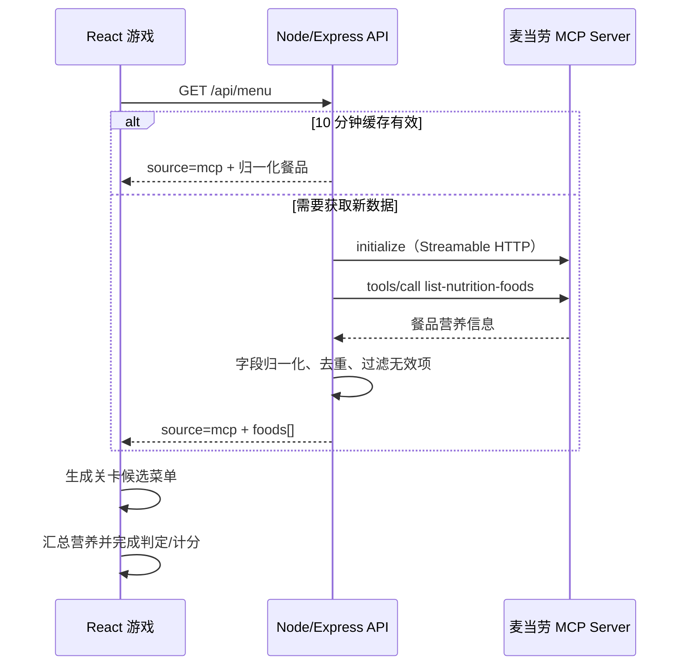

# 麦当劳 MCP 接入说明

## 1. 接入目标

1024 能量栈需要一份可随官方数据更新的餐品营养菜单。项目不把营养表写死为正式游戏数据，而是通过麦当劳 MCP 获取餐品营养信息，用这些数据完成三件事：

1. 生成每轮 8 件候选餐品；
2. 实时汇总玩家所选餐品的能量、蛋白质、脂肪、碳水化合物和钠；
3. 根据关卡能量区间、蛋白质下限和钠上限进行判定与计分。

因此，MCP 返回值会直接改变候选菜单、营养仪表和关卡结果，是游戏核心数据源，而不是装饰性展示。

## 2. Server 与 Tool

| 项目 | 内容 |
| --- | --- |
| MCP Server | `https://mcp.mcd.cn` |
| 传输协议 | Streamable HTTP |
| 认证 | `Authorization: Bearer ${MCD_MCP_TOKEN}` |
| 使用 Tool | `list-nutrition-foods` |
| Tool 业务含义 | 获取常见餐品的能量、蛋白质、脂肪、碳水化合物、钠、钙等营养信息 |

本项目使用官方 TypeScript SDK 的 `Client` 与 `StreamableHTTPClientTransport`，并使用 legacy 协议协商模式连接兼容 2025 版本的官方服务。

## 3. 调用流程



相关代码：

- `server/mcdMcpClient.js`：连接官方 MCP Server 并调用 `list-nutrition-foods`。
- `server/nutrition.js`：兼容中英文营养字段，将不同返回包装归一化为游戏数据。
- `server/index.js`：提供 `/api/menu`、10 分钟缓存与错误状态。
- `src/hooks/useMenu.js`：识别 `MCP LIVE` / `DEMO MODE`，把数据交给游戏。
- `src/lib/game.js`：营养汇总、关卡生成与计分。

## 4. 归一化数据结构

前端只接收游戏所需的最小字段：

```json
{
  "id": "餐品标识",
  "name": "餐品名称",
  "category": "burger | side | drink | nugget",
  "energy": 388,
  "protein": 18.2,
  "fat": 17,
  "carbs": 35,
  "sodium": 720
}
```

单位约定：能量为 kcal，蛋白质/脂肪/碳水为 g，钠为 mg。解析器会从数值或带单位字符串中提取数值，并过滤没有餐品名称、能量或营养字段的包装对象。

## 5. 游戏中的业务价值

传统营养列表要求用户主动比较多个数字。游戏把这些数字转换为即时反馈：

- **能量区间**让玩家理解“总量接近”而不是机械追求越低越好；
- **蛋白质下限**避免只用低热量饮品凑分；
- **钠上限**让高蛋白但高钠的组合产生真实取舍；
- **三轮递增目标**帮助玩家在重复选择中形成餐品营养直觉。

最终形成“官方数据 → 可玩的选择 → 可解释的反馈 → 更直观的营养认知”闭环。

## 6. 缓存、限流与降级

- 服务端成功获取后缓存 10 分钟，减少重复 MCP 调用。
- 页面刷新按钮使用 `?refresh=1` 主动跳过缓存。
- Token 未配置、认证失败、网络失败或返回数据不足时，API 返回明确错误；前端切换到 `DEMO MODE`。
- 演示数据只用于保证项目可试玩，界面不会把它标记为官方 MCP 实时数据。
- 正式参赛演示时应配置真实 `MCD_MCP_TOKEN`，确认状态为 `MCP LIVE`。

## 7. 信息安全

- 真实 Token 只存在于服务端环境变量 `MCD_MCP_TOKEN`。
- 前端不读取、不保存、不打印 Token。
- 示例配置只包含 `${MCD_MCP_TOKEN}` 占位符。
- `.env` 与 `.env.*` 默认不进入 Git。
- 错误响应只返回可诊断信息，不回显请求头或 Token。

## 8. 本地核验步骤

1. 从麦当劳 MCP 开放平台申请 Token。
2. 复制 `.env.example` 为 `.env` 并填写 Token。
3. 运行 `npm run dev`。
4. 打开游戏，确认右侧状态显示 `MCP LIVE`。
5. 点击刷新按钮，确认菜单仍可载入且候选餐品来自 MCP。
6. 选择餐品，确认能量、蛋白质、钠和碳水实时变化。
7. 提交配餐，确认判定结果与汇总数值一致。

> 请勿在截图、Issue、日志或 Git 历史中暴露真实 Token。
