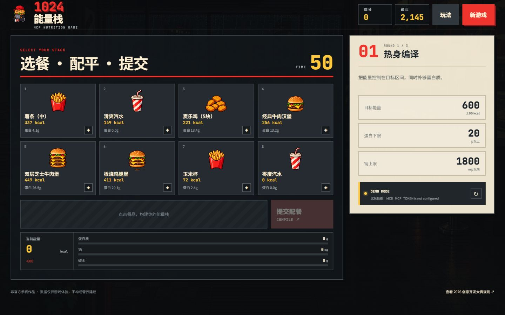

# 1024 能量栈

> 一款由麦当劳 MCP 实时营养数据驱动的配餐闯关游戏。



玩家不是在背热量表，而是在 50 秒内完成一道真实的“约束编译题”：从餐品中选择最多 4 件，让总能量落在目标区间，同时满足蛋白质下限和钠上限。连续通过「热身编译」「性能优化」「1024 终极栈」三轮，获得最高分。

## 为什么做这个游戏

营养信息往往以表格出现，数据准确，但不容易形成直觉。1024 能量栈把官方 MCP 返回的能量、蛋白质、碳水、脂肪和钠变成实时游戏规则，让用户在“选错—反馈—重试”中理解不同餐品组合的取舍。

- **真实数据驱动**：服务端调用麦当劳 MCP `list-nutrition-foods`。
- **不是静态题库**：菜单来自 MCP 返回结果，关卡候选餐品会随数据变化。
- **可解释反馈**：每轮分别判断能量、蛋白质和钠，不只给一个总分。
- **可完整试玩**：未配置 Token 时自动使用明确标注的本地演示数据，不伪装成 MCP 实时结果。
- **多端可玩**：支持鼠标、触屏和键盘（`1`—`8` 选餐、`Enter` 提交、`R` 重开）。

## 快速开始

要求：Node.js 20 或更高版本。

```bash
npm install
copy .env.example .env
```

在 `.env` 中填写从麦当劳 MCP 开放平台申请的 Token：

```dotenv
MCD_MCP_TOKEN=你的真实_Token
MCD_MCP_URL=https://mcp.mcd.cn
PORT=8787
```

不要把 `.env` 或真实 Token 提交到 GitHub。

开发模式：

```bash
npm run dev
```

生产模式：

```bash
npm run build
npm start
```

打开 [http://localhost:8787](http://localhost:8787)。

## 游戏规则

1. 每轮从 8 件候选餐品中选择最多 4 件。
2. 让总能量落在目标值的容差范围内。
3. 同时达到蛋白质下限，并且不超过钠上限。
4. 越接近目标、提交越快，得分越高；能量误差不超过 20 kcal 还有额外奖励。
5. 连续完成三轮，第三轮目标为 1024 kcal。

顶部数据状态会明确显示：

- `MCP LIVE`：已成功载入麦当劳 MCP 数据。
- `DEMO MODE`：Token 未配置或 MCP 暂时不可用，当前使用演示数据。

## MCP 接入

本项目使用：

- MCP Server：`https://mcp.mcd.cn`
- 传输协议：Streamable HTTP
- 认证方式：`Authorization: Bearer ${MCD_MCP_TOKEN}`
- Tool：`list-nutrition-foods`
- 用途：取得餐品名称及能量、蛋白质、脂肪、碳水化合物、钠等营养数据，生成每轮候选菜单并实时判定玩家配餐。

完整调用流程、字段归一化、缓存与错误降级策略见 [MCP_INTEGRATION.md](MCP_INTEGRATION.md)。脱敏连接示例见 [mcp-config.example.json](mcp-config.example.json)。

## 项目结构

```text
.
├─ server/
│  ├─ index.js              # API、缓存与生产静态服务
│  ├─ mcdMcpClient.js       # MCP 客户端与 Tool 调用
│  └─ nutrition.js          # MCP 返回数据归一化
├─ src/
│  ├─ components/           # 游戏 UI 组件
│  ├─ hooks/useMenu.js      # MCP/试玩数据状态管理
│  └─ lib/game.js           # 关卡、计分与精灵映射
├─ public/assets/           # 原创像素美术资源
├─ docs/                    # 截图与设计概念
├─ CONTEST_DECLARATION.md   # 官方参赛声明原文
├─ MCP_INTEGRATION.md
└─ mcp-config.example.json
```

## 测试

```bash
npm test
npm run build
```

测试覆盖 MCP 营养字段归一化、非餐品包装对象过滤、营养汇总与关卡计分。

## 安全与合规

- Token 只从服务端环境变量读取，不会进入浏览器 bundle。
- `.env` 已加入 `.gitignore`。
- `mcp-config.example.json` 只使用环境变量占位符。
- MCP 数据在服务端缓存 10 分钟，避免重复调用；界面刷新可显式重新获取。
- 本项目为参赛者独立开发的非官方作品，不代表麦当劳官方立场。
- 营养数据与游戏得分仅供体验，不构成医疗或营养建议；实际餐品信息以官方渠道为准。

## 参赛文件检查

- [x] `README.md`
- [x] `CONTEST_DECLARATION.md`（从官方活动仓库原样复制）
- [x] `MCP_INTEGRATION.md`
- [x] `mcp-config.example.json`
- [x] 可运行源代码
- [ ] `workbuddy.md`（仅在真实使用 WorkBuddy 并参加专项奖励时，导出真实对话上下文后添加）

报名 Issue 文案草稿见 [docs/ISSUE_SUBMISSION.md](docs/ISSUE_SUBMISSION.md)。

## 免责声明

本项目未使用麦当劳官方 Logo、金色拱门或官方包装美术。项目中的像素餐品与角色为本项目原创生成资产。活动规则、资格与奖励以 [麦当劳程序员创意开发大赛官方仓库](https://github.com/M-China/mcd-developer-innovation-challenge) 为准。

## License

[MIT](LICENSE)
